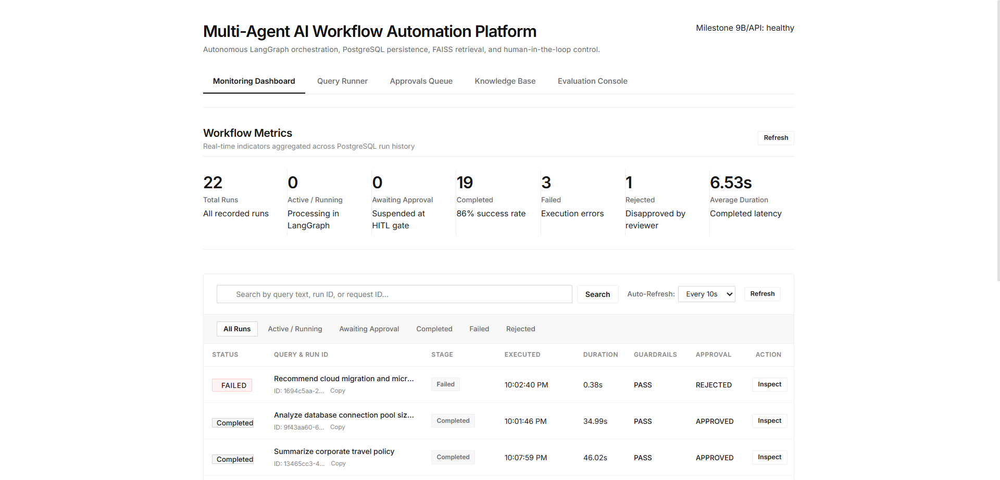
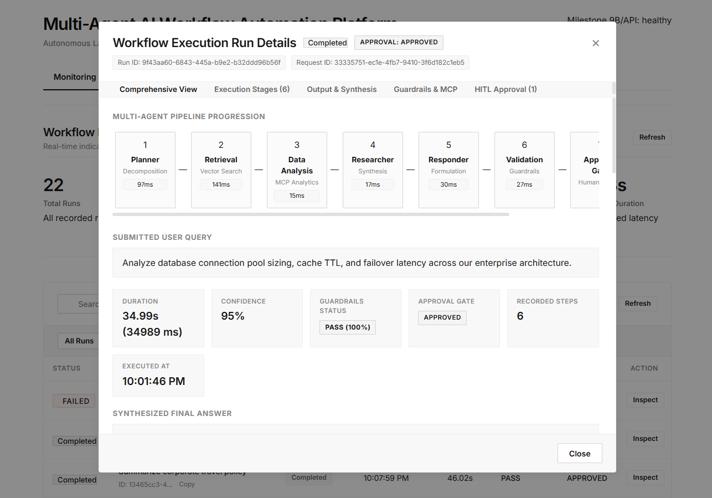
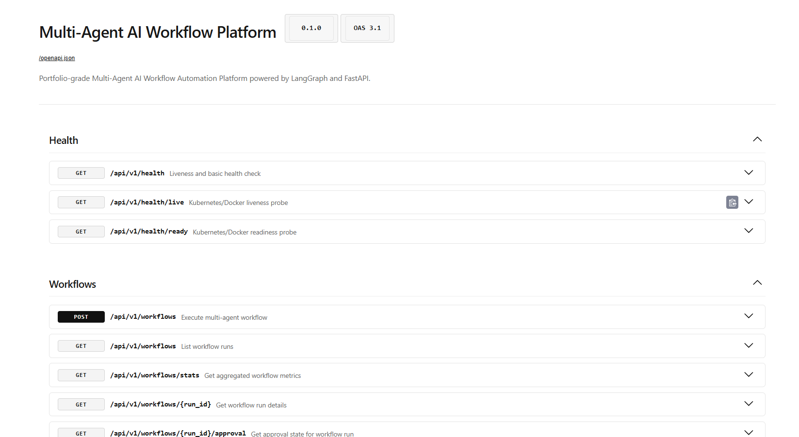
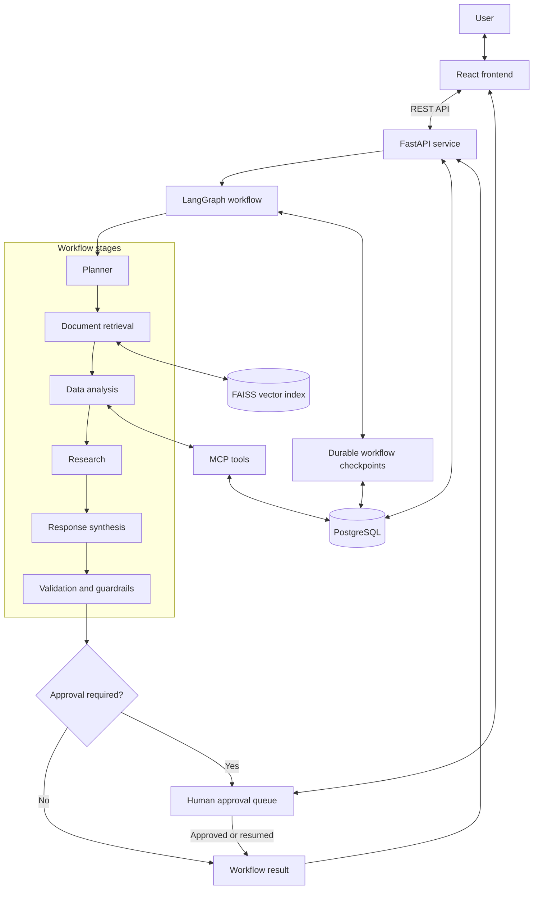

# Multi-Agent AI Workflow Automation Platform

[](https://www.python.org/)
[](https://fastapi.tiangolo.com/)
[](https://github.com/langchain-ai/langgraph)
[](https://react.dev/)
[](https://www.postgresql.org/)
[](https://docs.docker.com/compose/)

A full-stack platform for orchestrating multi-agent AI workflows, retrieving information from engineering documents, running analytical tools, reviewing approval-gated actions, and evaluating workflow quality. The backend uses FastAPI and LangGraph, with PostgreSQL for persistence, FAISS for vector retrieval, and a React interface for monitoring and evaluation.

The project includes workflow execution history, human-in-the-loop approval paths, document ingestion and retrieval, structured validation, and a benchmark evaluation console. The default configuration uses mock model and embedding providers for deterministic local development; real-provider performance must be validated separately.

## Screenshots

### Monitoring dashboard

The dashboard presents workflow metrics, recent runs, execution status, guardrail results, and approval decisions.



### Workflow execution details

The run inspector shows the agent pipeline, individual stage timings, guardrail results, approval state, and final response.



### API documentation

The FastAPI Swagger UI exposes the service's generated OpenAPI documentation and interactive endpoint testing.



## Contents

- [Capabilities](#capabilities)
- [Architecture](#architecture)
- [Technology stack](#technology-stack)
- [Repository layout](#repository-layout)
- [Quick start with Docker Compose](#quick-start-with-docker-compose)
- [Configuration](#configuration)
- [Workflow lifecycle](#workflow-lifecycle)
- [Document retrieval](#document-retrieval)
- [Evaluation system](#evaluation-system)
- [API reference](#api-reference)
- [Testing](#testing)
- [Limitations and production considerations](#limitations-and-production-considerations)
- [License](#license)

## Capabilities

- **Multi-agent orchestration:** coordinates specialised planner, retrieval, data-analysis, research, response, and validation stages through a LangGraph workflow.
- **Workflow persistence:** stores workflow runs and execution history in PostgreSQL.
- **Human-in-the-loop approval:** allows workflows to pause for review and supports approval decisions and resumption through the existing approval flow.
- **Document retrieval:** ingests supported document formats, chunks content, indexes vectors in FAISS, and retrieves relevant passages for downstream stages.
- **Analytical tools:** integrates MCP tool execution for supported data-analysis operations.
- **Validation and guardrails:** applies structured validation and configured checks to workflow outputs; recoverable errors may be routed through bounded retry logic.
- **Monitoring interface:** provides workflow history, status metrics, execution details, and approval information.
- **Evaluation console:** supports benchmark runs, run history, per-case diagnostics, comparisons, and JSON report viewing or export.
- **API reference:** exposes interactive Swagger documentation through FastAPI.
- **Containerized development:** uses Docker Compose to run the application services together.

Exact execution paths can depend on the query, configured providers, and workflow state. The list above describes platform capabilities rather than claiming that every agent runs for every request.

## Architecture

The diagram below is a simplified view of the main components. The actual workflow and integrations are defined by the code and configuration in this repository.



### Component responsibilities

| Component | Responsibility |
|---|---|
| React frontend | Workflow submission, monitoring, run inspection, approvals, document management, and evaluation views. |
| FastAPI | HTTP endpoints, request validation, service coordination, health checks, and generated OpenAPI documentation. |
| LangGraph | Stateful coordination of workflow stages and conditional transitions. |
| PostgreSQL | Durable application records and workflow history; checkpoint persistence is used where configured. |
| FAISS | Vector similarity search over indexed document chunks. |
| MCP tools | Provides supported tool interfaces for analytical operations. |
| Evaluation subsystem | Runs benchmark cases, calculates configured metrics, persists results, and compares runs. |

## Technology stack

| Area | Technology | Purpose |
|---|---|---|
| Language | Python | Backend services and workflow implementation. |
| API | FastAPI | REST endpoints, health checks, and Swagger documentation. |
| Orchestration | LangGraph | Stateful multi-agent workflow execution. |
| Frontend | React and Vite | Single-page monitoring and evaluation interface. |
| Persistence | PostgreSQL | Workflow records, history, and configured checkpoint storage. |
| Vector search | FAISS | Similarity search over document embeddings. |
| Document processing | PyMuPDF and text/Markdown loaders, where configured | Document parsing and preparation for retrieval. |
| Tool integration | Model Context Protocol (MCP) | Tool interfaces for supported analysis operations. |
| Data validation | Pydantic | Request and structured data validation. |
| Testing | pytest and Node.js test runner | Backend and frontend tests. |
| Containerization | Docker and Docker Compose | Local multi-service development and verification. |

Check the dependency and configuration files in the current branch for exact package versions and supported provider options.

## Repository layout

The repository is organised around the backend service, frontend application, automated tests, deployment files, and documentation. Key areas include:

```text
multi-agent-workflow-platform/
├── backend/
│   ├── app/                 # FastAPI application, agents, graph, services, API routes
│   ├── tests/               # Backend tests
│   └── Dockerfile
├── frontend/
│   ├── src/                 # React application and components
│   ├── test/                # Frontend tests
│   ├── package.json
│   └── Dockerfile
├── docs/
│   ├── screenshots/                 # README screenshots
│   ├── architecture.md              # Architecture specification
│   ├── deployment.md                # Deployment guidance
│   ├── evaluation.md                # Evaluation subsystem documentation
│   └── PROJECT_COMPLETION_REPORT.md # Milestone-by-milestone report
├── docker-compose.yml
├── .env.example
└── README.md
```

This is a high-level guide rather than a complete file inventory. Refer to the current repository tree for every file and module.

## Quick start with Docker Compose

### Prerequisites

- Docker Desktop with Docker Compose available.
- Git, if cloning the repository.

### 1. Clone the repository

```powershell
git clone https://github.com/chargedleo/multi-agent-workflow-platform.git
cd multi-agent-workflow-platform
```

If you already have the repository locally, open PowerShell in the repository directory instead.

### 2. Configure environment variables

If `.env.example` is present in the repository root, copy it to `.env`:

```powershell
Copy-Item .env.example .env
```

Open `.env` and review the settings before starting the stack. Do not commit `.env` or any file containing credentials.

### 3. Build and start services

```powershell
docker compose up --build -d
```

Check service status:

```powershell
docker compose ps
```

Check the backend health endpoint:

```powershell
Invoke-RestMethod http://localhost:8000/api/v1/health
```

### 4. Open the application

| Service | URL |
|---|---|
| React frontend | <http://localhost:5173> |
| FastAPI Swagger UI | <http://localhost:8000/docs> |
| OpenAPI schema | <http://localhost:8000/openapi.json> |
| Health check | <http://localhost:8000/api/v1/health> |

### View logs and stop services

```powershell
# Follow backend logs
docker compose logs -f backend

# View recent logs for all services
docker compose logs --tail=100

# Stop services; named database volumes are normally retained
docker compose down
```

Do not add `-v` to `docker compose down` unless you intend to remove the Compose-managed volumes and their stored data.

## Configuration

Review `.env.example` and the backend configuration module to see the environment variables supported by the current branch. Depending on the selected features and providers, settings may include:

| Setting | Purpose |
|---|---|
| `LLM_PROVIDER` | Selects the configured language-model provider. The reported default is `mock`. |
| `EMBEDDING_PROVIDER` | Selects the configured embedding provider. The reported default is `mock`. |
| `LLM_API_KEY` | Credential for an external LLM provider, when required. |
| `DATABASE_URL` | PostgreSQL connection URL used by the application. |
| `FAISS_INDEX_PATH` | Location for persisted FAISS data, if configured under this name. |

The exact variable names, accepted values, and defaults must be taken from `.env.example` and the current configuration code. Do not assume every variable above is present in every deployment configuration.

### Mock and real-provider behaviour

The development configuration reported for this project uses mock LLM and embedding providers to support deterministic local runs and tests without paid model API calls. Native FAISS retrieval, PostgreSQL persistence, and LangGraph integration are distinct from the choice of model provider.

To evaluate real answer quality, configure a supported real model and embedding provider according to the project's current configuration. Record the provider, model, dataset, and run settings when sharing evaluation results. Mock-provider test results should not be presented as evidence of real-model performance.

## Workflow lifecycle

A typical workflow may include these stages, depending on the query and graph routing:

1. The user submits a business or technical query through the frontend or API.
2. FastAPI validates the request and starts the workflow.
3. The planner produces a structured task plan.
4. Retrieval and/or analysis stages use relevant documents or supported tools.
5. Research and response stages synthesise the available evidence.
6. Validation applies the configured output and guardrail checks.
7. If an approval gate is required, the workflow can pause for a human decision; otherwise it can return its result.
8. Run status and execution information are recorded for inspection.

The precise order and state transitions should be checked against the current graph implementation. In particular, rejection and revision decisions should be described according to the statuses produced by the current code.

## Human-in-the-loop approvals

The application includes an approval queue for workflows that require human review. The interface exposes the relevant run information and available decisions. The backend handles the approval lifecycle and workflow continuation according to its current implementation.

Where durable checkpointing is enabled, workflow state can be persisted so an interrupted process can resume. Verify the configured checkpoint backend and restart behaviour before relying on this property in a production deployment.

## Document retrieval

The retrieval subsystem is designed to ingest supported documents, parse and chunk their content, create or use embeddings, and search the FAISS index for relevant passages. Retrieved material can be used by downstream workflow stages and surfaced during run inspection.

The repository reports support for PDF, text, and Markdown input. Check current loaders and ingestion validation for the authoritative file types, size limits, chunk settings, metadata fields, and deletion behaviour.

## Evaluation system

The platform includes a benchmark evaluation engine and React evaluation console. The reported benchmark contains 35 cases. Available evaluation modes and metrics depend on the current implementation and configuration.

Reported metric families include retrieval measures such as Recall@k, Precision@k, MRR, and MAP, as well as configured citation, factual coverage, abstention, and guardrail checks. The evaluation interface supports run history, per-case inspection, comparison, and JSON report viewing or export where implemented.

Interpret metrics carefully:

- A metric-only run may evaluate stored ground truth or retrieval behaviour without exercising a live model end to end.
- An integration run exercises more of the configured system but can depend on provider settings and available data.
- Structural tests can confirm schemas and expected fields; they do not independently prove that every ground-truth label is semantically correct.
- Results from mock providers are not comparable to real-model quality without further validation.

Use the Evaluation Console and Swagger documentation to inspect the exact modes, parameters, and report structure available in the current branch.

## API reference

Interactive API documentation is available when the backend is running:

- Swagger UI: <http://localhost:8000/docs>
- OpenAPI schema: <http://localhost:8000/openapi.json>

The workflow API includes endpoints for health checks, starting and listing runs, retrieving run details and statistics, and handling approval decisions. The document and evaluation APIs expose the operations implemented by the current backend. The generated OpenAPI schema is the authoritative reference for exact paths, methods, request bodies, and response models.

A few endpoints visible in the current interface include:

| Method | Path | Purpose |
|---|---|---|
| `GET` | `/api/v1/health` | Basic health check. |
| `GET` | `/api/v1/health/live` | Liveness probe. |
| `GET` | `/api/v1/health/ready` | Readiness probe. |
| `POST` | `/api/v1/workflows` | Submit a workflow. |
| `GET` | `/api/v1/workflows` | List workflow runs. |
| `GET` | `/api/v1/workflows/stats` | Retrieve aggregate workflow metrics. |
| `GET` | `/api/v1/workflows/{run_id}` | Retrieve a workflow run's details. |
| `GET` | `/api/v1/workflows/{run_id}/approval` | Retrieve a run's approval state. |
| `POST` | `/api/v1/workflows/{run_id}/approval` | Submit an approval decision. |

## Testing

Run the tests from the repository root in an environment with the backend dependencies installed:

```powershell
python -m pytest backend/tests -q
```

Run the frontend tests and production build:

```powershell
Set-Location frontend
npm install
npm test
npm run build
```

The latest recorded verification for this project reported 189 passing backend tests, 13 passing frontend tests, and a successful Vite production build. These results describe that verification run, not a guarantee for every branch or environment. Re-run the tests on the exact commit you intend to publish.

## Limitations and production considerations

- The default mock providers are useful for development and deterministic tests but do not establish real-model quality.
- Real-provider integration depends on valid credentials, provider availability, configuration, and potential usage costs.
- Retrieval quality depends on the embedding provider, indexed content, chunking, and the correctness of evaluation ground truth.
- Performance under large workloads, concurrent users, and production-scale data should be benchmarked separately.
- Before exposing the service publicly, review authentication and authorisation, CORS, secret management, upload validation, rate limits, logging, backups, and deployment configuration.
- Confirm the repository's current behaviour and dependencies before using exact version or capacity claims in external documentation.

## Project completion report

For the milestone-by-milestone engineering history, see [`docs/PROJECT_COMPLETION_REPORT.md`](docs/PROJECT_COMPLETION_REPORT.md). It covers the objectives, implementation, validation evidence, and remaining limitations for milestones M1 through M9B.

## License

Check the repository root for a `LICENSE` file and refer to it for the applicable terms. If the file is missing, add the license you intend to use before representing the repository as licensed under a specific license.
