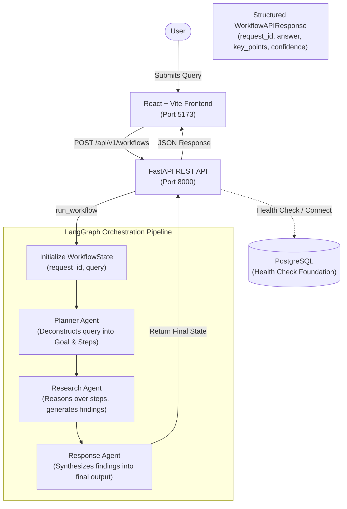
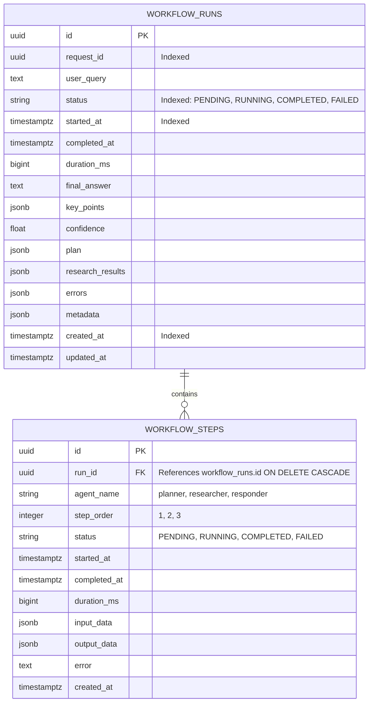
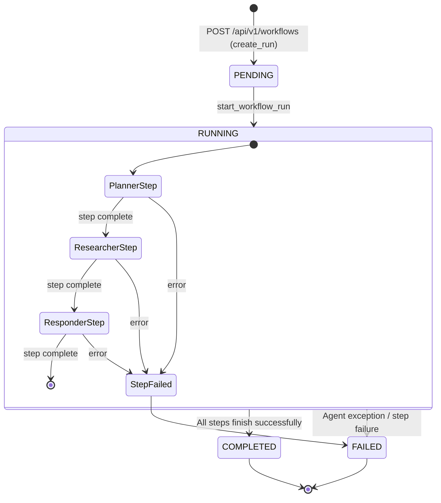
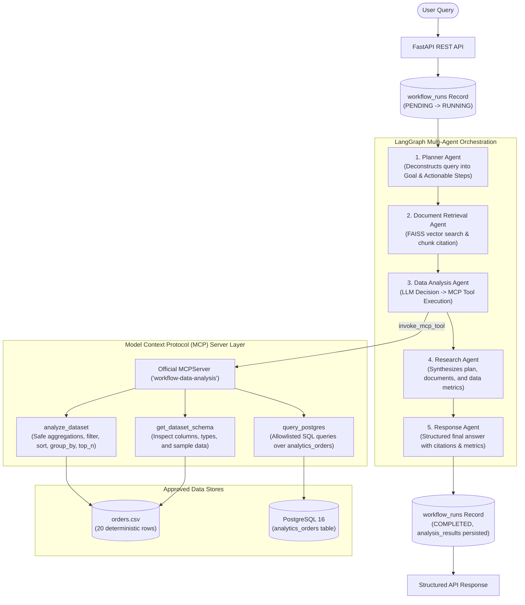

# System Architecture — Multi-Agent AI Workflow Automation Platform

This document describes the architectural foundation established in **Milestone 1** and outlines the roadmap toward the full multi-agent enterprise platform.

---

## 1. Milestone 1 Architecture

Milestone 1 proves that a multi-agent orchestration workflow built on **LangGraph** and **FastAPI** can process a complex business query through shared state and return validated, structured answers.

### 1.1 Milestone 1 Component Flow



---

## 2. Shared LangGraph State Design

The core of multi-agent collaboration in this platform is strongly typed, shared state represented by `WorkflowState`:

```python
class WorkflowState(TypedDict, total=False):
    # Core attributes (Milestone 1)
    request_id: str
    user_query: str
    plan: Optional[Dict[str, Any]]                # Validated Plan
    research_results: Optional[Dict[str, Any]]    # Validated ResearchResult
    intermediate_results: Annotated[List[Dict[str, Any]], operator.add]
    final_answer: Optional[Dict[str, Any]]        # Validated WorkflowResponse
    errors: Annotated[List[str], operator.add]   # Accumulated errors
    metadata: Dict[str, Any]

    # Future extension points (Milestones 2+)
    retrieved_documents: Optional[List[Dict[str, Any]]]
    analysis_results: Optional[Dict[str, Any]]
    validation_results: Optional[Dict[str, Any]]
    tool_calls: Optional[List[Dict[str, Any]]]
    approval_status: Optional[str]
```

### Key State Characteristics:
1. **Additive Reducers (`operator.add`)**: Fields like `errors` and `intermediate_results` append state updates from every node rather than overwriting previous entries.
2. **Immutability & Safety**: Each agent receives the full state, inspects earlier outputs, produces its typed output, and returns only the delta dictionary.
3. **Decoupled Extensions**: Later agents (e.g., Document Retrieval, Data Analysis) can add fields directly into the existing state schema without requiring refactoring of existing agents.

---

## 3. Agent Responsibilities & Schemas

### 3.1 Planner Agent (`backend/app/agents/planner.py`)
- **Input**: `state["user_query"]`
- **Output Schema**: `Plan`
  - `goal: str`: Objective extracted from the query.
  - `steps: List[str]`: Chronological, actionable steps.
- **Responsibility**: Deconstructs high-level business queries into structured execution milestones.

### 3.2 Research Agent (`backend/app/agents/researcher.py`)
- **Input**: `state["plan"]`, `state["user_query"]`
- **Output Schema**: `ResearchResult`
  - `findings: List[str]`: In-depth analytical points addressing each planned step.
  - `assumptions: List[str]`: Assumptions explicitly recognized during reasoning.
  - `unanswered_questions: List[str]`: Open questions or variables requiring more context.
- **Responsibility**: In Milestone 1, functions as an LLM-based reasoning agent over the plan. In Milestone 3+, will leverage external tools and MCP servers.

### 3.3 Response Agent (`backend/app/agents/responder.py`)
- **Input**: `state["user_query"]`, `state["plan"]`, `state["research_results"]`
- **Output Schema**: `WorkflowResponse`
  - `request_id: str`: Propagation of the workflow run UUID.
  - `answer: str`: Comprehensive synthesized response.
  - `key_points: List[str]`: Bullet points summarizing actionable takeaways.
  - `confidence: float`: Calibrated confidence rating between `0.0` and `1.0`.
- **Responsibility**: Synthesizes agent work into a structured executive report.

---

## 4. Central LLM Abstraction (`backend/app/services/llm.py`)

To prevent tight coupling to a single AI provider, LLM instantiation is managed by a central factory:
- **Configurable Provider**: Controlled via `LLM_PROVIDER` (`openai`, `azure`, `ollama`, or `mock`).
- **OpenAI-Compatible Support**: Accepts custom `LLM_BASE_URL` (compatible with vLLM, LMStudio, local Ollama, etc.).
- **Built-in Mock Model (`MockChatModel`)**: A deterministic model that simulates structured output without requiring live API keys or incur costs during automated CI/CD and testing.
- **Resilient Fallback Parsing**: When native `.with_structured_output()` fails or is unsupported by an endpoint, the service automatically falls back to schema-guided JSON prompting and `PydanticOutputParser`.

---

## 5. PostgreSQL Persistence Architecture (Milestone 2)

Milestone 2 introduces enterprise persistence for multi-agent workflows, transforming transient LangGraph executions into durable audit trails.

### 5.1 Database Entity-Relationship Diagram



### 5.2 Workflow & Step Lifecycle

The execution lifecycle transitions through deterministic states:



### 5.3 Architectural Rationale: Separation of LangGraph State vs. DB Persistence

1. **In-Memory LangGraph State (`WorkflowState`)**:
   - Optimized for ultra-low latency intra-agent message passing and fast functional transitions.
   - Preserves typed immutability and additive reducers (`operator.add`) during runtime execution.
   - Contains operational working memory and internal prompts without tying the execution loop to database write patterns.

2. **Durable Database Persistence (`WorkflowRun` & `WorkflowStep`)**:
   - Provides an asynchronous, queryable audit log accessible across restarts and external services.
   - Captures wall-clock execution metrics (`duration_ms`), agent latency, error traces, and input/output snapshots.
   - Enables pagination, history filtering, performance observability, and future replay capabilities.

3. **Transaction Boundary Decoupling**:
   - Database operations use isolated, short-lived transactions (`get_db_context()`) at step entry and step completion.
   - **Crucially, database transactions are never held open across external LLM network calls**. Step records are created immediately before invocation and committed, then updated upon completion in a separate transaction.

---

---

## 6. Milestone 4 Architecture: Data Analysis Agent & MCP Tool Layer

Milestone 4 incorporates structured quantitative reasoning into the platform through an official Model Context Protocol (MCP 2.x) tool layer and a dedicated **Data Analysis Agent**:



### 6.1 Security & Control Boundary
- **Zero Arbitrary Execution**: Strict elimination of `eval()`, `exec()`, or dynamic code compilation.
- **Strict Allowlists**: Dataset allowlist (`orders.csv`), table allowlist (`analytics_orders`), and column allowlists.
- **SQL Injection Defense**: All database queries are constructed using SQLAlchemy parameterized expressions; unapproved column names, non-SELECT statements, and injection keywords (`DROP`, `DELETE`, `UNION`, `UPDATE`) are rejected before execution.
- **Standardized MCP Interface**: Integrates the official Python `mcp` 2.x SDK with typed JSON schemas and structured outputs.

---

## 7. Milestone 5 Architecture: Validation Guardrails & Agent Correction Loop

Milestone 5 implements a robust guardrail validation system and an automated, bounded agent correction loop:

```mermaid
flowchart TD
    User([User]) --> API["FastAPI Gateway"]
    API --> InitRun[("workflow_runs Record\n(PENDING → RUNNING)")]
    
    subgraph MultiAgentSystem ["Multi-Agent Execution & Guardrail Pipeline"]
        direction TB
        Planner["1. Planner Agent"]
        DocRetrieval["2. Document Retrieval Agent\n(FAISS Vector Store)"]
        DataAnalysis["3. Data Analysis Agent\n(MCP Tool Layer)"]
        Research["4. Research Agent"]
        Responder["5. Response Agent"]
        Validator{"6. Validation Guardrails\n(Schema, Math, Provenance, Claims)"}
        
        Planner --> DocRetrieval
        DocRetrieval --> DataAnalysis
        DataAnalysis --> Research
        Research --> Responder
        Responder --> Validator
        
        Validator -->|PASS| EndSuccess([Workflow Complete])
        Validator -->|RECOVERABLE\n(attempt < 2)| Responder
        Validator -->|FAIL / BLOCKED\n(or max attempts reached)| EndFail([Workflow Terminated / Failed])
    end

    InitRun --> Planner
    EndSuccess --> FinalRunSuccess[("workflow_runs Record\n(COMPLETED, validation_status: PASS)")]
    EndFail --> FinalRunFail[("workflow_runs Record\n(FAILED, validation_status: FAIL)")]
    FinalRunSuccess --> ResponseSuccess["Structured API Response"]
    FinalRunFail --> ResponseFail["Error Audit Response"]
```

### 7.1 Modular Deterministic Validators
1. **Response Schema Validator** (`validate_response_schema`): Validates non-empty synthesized responses, required executive takeaways, calibrated confidence `[0.0, 1.0]`, and request ID parity.
2. **Citation Provenance Validator** (`validate_citations`): Ensures all citations link to actual documents and chunks retrieved during the run, flagging fabricated documents.
3. **Numerical Consistency Validator** (`validate_analysis_results`): Validates math consistency (`count >= 0`, `sum / count == mean`, `min <= mean <= max`, group row sum reconciliation).
4. **Tool Output Validator** (`validate_tool_outputs`): Verifies invocations match registered MCP tools, checks parameter types, and detects masked failures.
5. **Claim Verification Validator** (`validate_claims_and_numbers`): Extracts numerical and financial claims from synthesized text and matches them against verified analysis metrics and retrieved source documents to prevent hallucinated numbers.

### 7.2 Correction Loop Mechanics
- **Actionable Feedback**: When recoverable issues are identified, the validation engine packages structured feedback instructions and injects them directly into the Response Agent prompt.
- **Bounded Attempts**: Strict `MAX_VALIDATION_ATTEMPTS = 2` hard limit prevents infinite execution cycles.
- **Durable Traceability**: Every validation evaluation is recorded as a discrete step in `workflow_steps` (e.g. step order 6 on attempt 1, step order 8 on attempt 2) and stored in `metadata_json["validation"]`.

---

## 8. Target Future Architecture (Milestone 6)

The upcoming milestone will introduce:
- **Milestone 6**: Human-in-the-Loop (HITL) approval gates, live streaming execution with server-sent events (SSE), interactive run inspection, and visual agent analytics.

