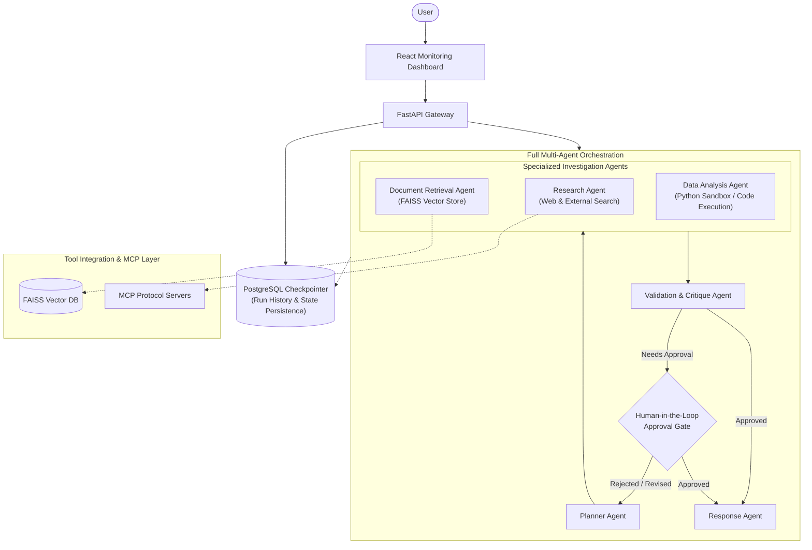

# System Architecture — Multi-Agent AI Workflow Automation Platform

This document describes the architectural foundation established in **Milestone 1** and outlines the roadmap toward the full multi-agent enterprise platform.

---

## 1. Milestone 1 Architecture

Milestone 1 proves that a multi-agent orchestration workflow built on **LangGraph** and **FastAPI** can process a complex business query through shared state and return validated, structured answers.

### 1.1 Milestone 1 Component Flow


---

## 2. Shared LangGraph State Design

The core of multi-agent collaboration in this platform is strongly typed, shared state represented by `WorkflowState`:

```python
class WorkflowState(TypedDict, total=False):
    # Core attributes (Milestone 1)
    request_id: str
    user_query: str
    plan: Optional[Dict[str, Any]]                # Validated Plan
    research_results: Optional[Dict[str, Any]]    # Validated ResearchResult
    intermediate_results: Annotated[List[Dict[str, Any]], operator.add]
    final_answer: Optional[Dict[str, Any]]        # Validated WorkflowResponse
    errors: Annotated[List[str], operator.add]   # Accumulated errors
    metadata: Dict[str, Any]

    # Future extension points (Milestones 2+)
    retrieved_documents: Optional[List[Dict[str, Any]]]
    analysis_results: Optional[Dict[str, Any]]
    validation_results: Optional[Dict[str, Any]]
    tool_calls: Optional[List[Dict[str, Any]]]
    approval_status: Optional[str]
```

### Key State Characteristics:
1. **Additive Reducers (`operator.add`)**: Fields like `errors` and `intermediate_results` append state updates from every node rather than overwriting previous entries.
2. **Immutability & Safety**: Each agent receives the full state, inspects earlier outputs, produces its typed output, and returns only the delta dictionary.
3. **Decoupled Extensions**: Later agents (e.g., Document Retrieval, Data Analysis) can add fields directly into the existing state schema without requiring refactoring of existing agents.

---

## 3. Agent Responsibilities & Schemas

### 3.1 Planner Agent (`backend/app/agents/planner.py`)
- **Input**: `state["user_query"]`
- **Output Schema**: `Plan`
  - `goal: str`: Objective extracted from the query.
  - `steps: List[str]`: Chronological, actionable steps.
- **Responsibility**: Deconstructs high-level business queries into structured execution milestones.

### 3.2 Research Agent (`backend/app/agents/researcher.py`)
- **Input**: `state["plan"]`, `state["user_query"]`
- **Output Schema**: `ResearchResult`
  - `findings: List[str]`: In-depth analytical points addressing each planned step.
  - `assumptions: List[str]`: Assumptions explicitly recognized during reasoning.
  - `unanswered_questions: List[str]`: Open questions or variables requiring more context.
- **Responsibility**: In Milestone 1, functions as an LLM-based reasoning agent over the plan. In Milestone 3+, will leverage external tools and MCP servers.

### 3.3 Response Agent (`backend/app/agents/responder.py`)
- **Input**: `state["user_query"]`, `state["plan"]`, `state["research_results"]`
- **Output Schema**: `WorkflowResponse`
  - `request_id: str`: Propagation of the workflow run UUID.
  - `answer: str`: Comprehensive synthesized response.
  - `key_points: List[str]`: Bullet points summarizing actionable takeaways.
  - `confidence: float`: Calibrated confidence rating between `0.0` and `1.0`.
- **Responsibility**: Synthesizes agent work into a structured executive report.

---

## 4. Central LLM Abstraction (`backend/app/services/llm.py`)

To prevent tight coupling to a single AI provider, LLM instantiation is managed by a central factory:
- **Configurable Provider**: Controlled via `LLM_PROVIDER` (`openai`, `azure`, `ollama`, or `mock`).
- **OpenAI-Compatible Support**: Accepts custom `LLM_BASE_URL` (compatible with vLLM, LMStudio, local Ollama, etc.).
- **Built-in Mock Model (`MockChatModel`)**: A deterministic model that simulates structured output without requiring live API keys or incur costs during automated CI/CD and testing.
- **Resilient Fallback Parsing**: When native `.with_structured_output()` fails or is unsupported by an endpoint, the service automatically falls back to schema-guided JSON prompting and `PydanticOutputParser`.

---

## 5. PostgreSQL Preparation & Persistence Roadmap

Milestone 1 establishes the connection pooling foundation using `SQLAlchemy` (with `asyncpg`):
- `DATABASE_URL` is fully configurable.
- `GET /api/v1/health` checks live database connectivity.
- A non-blocking health check verifies connectivity without preventing API startup if the database is temporarily offline.
- A dedicated Docker volume `workflow_postgres_data` ensures persistent database storage.

---

## 6. Target Future Architecture (Milestones 2 — 6)

The diagram below illustrates the target architecture to be incrementally implemented in future milestones:



### Future Milestone Roadmap:
- **Milestone 2**: PostgreSQL State Checkpointing, Run History API, and Persistent Workflow Replay.
- **Milestone 3**: Document Retrieval Agent with FAISS Vector Store and RAG integration.
- **Milestone 4**: Data Analysis Agent with sandboxed function calling and tool execution.
- **Milestone 5**: Validation Agent and Human-in-the-Loop (HITL) pause/resume approval gates.
- **Milestone 6**: Full React dashboard with real-time streaming, run inspection, and workflow management.
